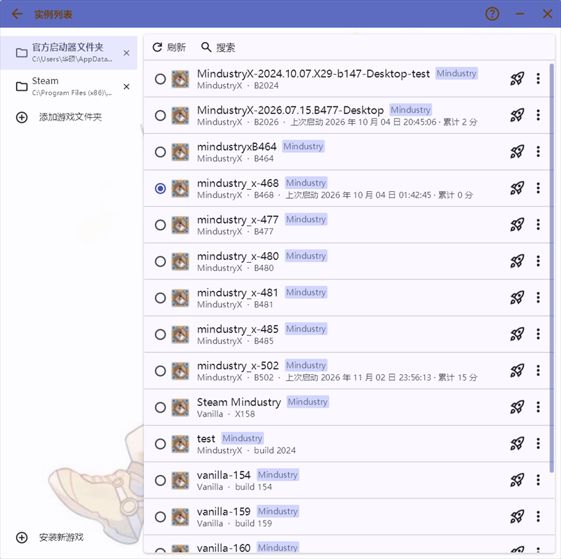
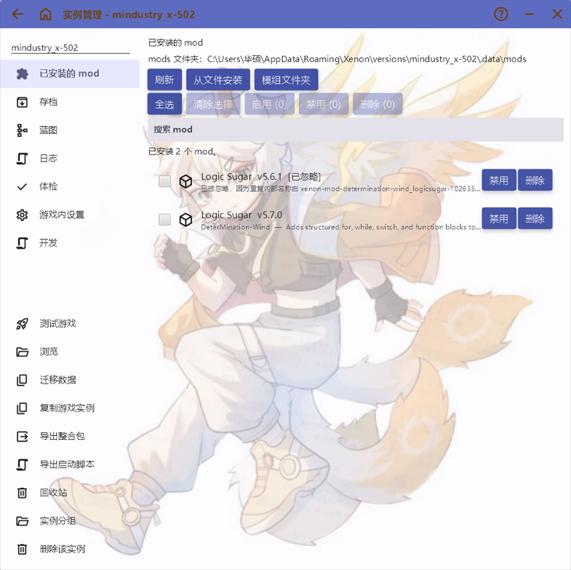

# Xenon - A Mindustry Launcher
<h1 align="center">
  
  
  
  
</h1>

> [!NOTE]
> 若有反馈，请发送反馈到 bugsoc@qq.com / If you have any feedback, please send it to bugsoc@qq.com

**中文** | [English](README_EN.md)

> 把 Mindustry 的版本、内容与服务器，放进一个清晰的工作台。

## 概览

Xenon 是面向 Mindustry 玩家和服主的跨平台桌面启动器与实例管理器。它把游戏安装、版本切换、Mod、地图、蓝图、存档、云存档、MDTBBS 社区、联机与服务器维护集中到一个入口，并让每个实例拥有独立的 Java、启动参数和数据目录。

Xenon 源自 [HMCL](https://github.com/HMCL-dev/HMCL)，但工作流围绕 Mindustry 重新组织。中国大陆用户可通过内置镜像、Wayzer 的 GitHub 镜像、MDT BBS 文件站与公共 GitHub 镜像获得 1–30 MB/s 的下载体验；原版安装包优先走 MDT 文件站，失败时自动回退。

## 界面预览

下表截图取自 Xenon 2.1.0 的实际运行界面（Windows，浅色主题，真实本地实例）。

| 实例列表 | 下载与版本选择 |
| :---: | :---: |
|  |  |
| **实例详情与 Mod 管理** | **联机（MDTBBS 1.8）** |
|  |  |

## 核心能力

- **实例隔离与版本管理**：原版、BE、MindustryX、CN-ARC、Foo Client、本地 jar 与 Steam 安装可以并存并可选各自隔离。
- **安装与下载**：自动准备 Java 与数据目录，支持断点续传、暂停/继续、下载来源档位、和镜像加速。
- **内容管理**：Mod 国内镜像索引和资源、Mod 批量启停、拖拽导入；WZ/MDTBBS地图、蓝图启动器内浏览安装与导入导出；游戏外 `settings.bin` 表格化编辑与备份。
- **存档与云存档**：本地备份/导出、删除进回收站、长会话退出后自动备份；云存档支持单存档快照、冲突保留两份、文件级差量快照，以及整实例归档和按实例自动同步。
- **MDTBBS 联机**：公开房间大厅、按可见范围与加入权限建房、房主审批、实时事件、好友邀请/加入动作、按用户名搜索并邀请，以及伪局域网自动发现，客人可直接从游戏内 LAN 列表进入。所有操作在游戏内完成。
- **服务器管理**：多服务器实例、控制台、自动重启，以及自动配置 [ScriptAgent4Mindustry](https://github.com/way-zer/ScriptAgent4Mindustry) 脚本环境。
- **排障与维护**：游戏外导出实例日志、崩溃报告；游戏外提供兼容检查、内存建议、实例迁移、回收站功能。

## 快速开始

1. 下载 [最新 Release](https://github.com/DeterMination-Wind/Xenon/releases)：Windows 用单文件 `Xenon.exe`，macOS/Linux 用 `.jar`（需要 Java 17+）。
2. 启动 Xenon，选择 `Install Mindustry` 并安装一个版本。
3. 打开 `Mindustry Versions`，启动实例；首次启动会自动准备数据目录。
4. 需要登录 MDTBBS 时，按提示在系统浏览器完成 MindAuth 授权登录你的 MDTBBS账号。

## 与竞品的比较

<!-- LAST_UPDATED:START -->
最后更新：**v2.1.0**（2026-11-08）
<!-- LAST_UPDATED:END -->

> 按各项目公开文档与 GitHub REST API 整理。竞品能力可能随版本变化，请以各自项目为准。

| 能力 | Xenon | [BookMdtLauncher](https://github.com/ch-BookBanana/BookMdtLauncher) | [Copper Launcher](https://github.com/MDTCopper/launcher) | [MDL](https://github.com/colorgarden/mindustry_launcherMDL) | [MindustryLauncher](https://github.com/BalaM314/MindustryLauncher) |
| --- | --- | --- | --- | --- | --- |
| 平台 / 形态 | Windows / Linux / macOS · 图形界面 | Windows · 图形界面（PySide6，单文件便携） | Windows / Linux / macOS / Android · 图形界面（Flutter，开发阶段） | Windows 7+ · 图形界面（WPF，需 .NET 10） | Windows / Linux / macOS · 命令行（需 Node.js） |
| 移动端运行（Android） | ❌ 桌面启动器；同维护者另有 [Xenon-Mobile](https://github.com/DeterMination-Wind/Xenon-Mobile) | ❌ | ✅ 自带 Java 与 Copper 桥（Mod 支持开发中） | ❌ | ❌ |
| 游戏来源 | 原版 / BE / MindustryX / CN-ARC / Foo Client，本地 jar 与 Steam 导入 | 原版 / MindustryX / MindustryARC | 原版 / BE | 原版 | 原版 / BE / Foo Client，自定义 jar 与源码目录 |
| Java 管理 | ✅ 多运行时、自动检测、Adoptium 下载、按版本匹配 | ✅ 自动嗅探与竞速下载 | ✅ 多运行时与自动下载 | ✅ 扫描与内存分配 | ⚠️ 仅配置路径 |
| 实例隔离 | ✅ 独立数据目录 | ✅ | ✅ | ✅ | ⚠️ 仅版本目录 |
| Mod 管理 | ✅ 社区索引、GitHub 直装、启停、依赖补齐 | ❌ | ✅ 浏览、启停、搜索 | ✅ 浏览、搜索、安装 | ⚠️ 面向开发 |
| Mod 批量 / 拖拽 | ✅ 批量启停删除、拖入文件/文件夹、自动拆包 | ❌ | ✅ 多选、拖入、Windows 拖出 | ❌ | ❌ |
| 地图 / 蓝图 | ✅ mindustry.top、.msch、分享码、资源页 | ❌ | ⚠️ 资源导入导出 | ✅ 社区蓝图 | ❌ |
| 存档 | ✅ 备份/导出、回收站、自动备份 | ❌ | ⚠️ 资源与云存档（开发中） | ✅ 扫描/解析/删除 | ❌ |
| 云存档 | ✅ 单存档冲突处理 + 整实例归档 + 文件级差量（manifest）+ 自动同步 | ❌ | ⚠️ 整包/同步/冲突副本、差量/清单快照（开发中） | ❌ | ❌ |
| settings.bin 编辑 | ✅ 全量表格、搜索、自动备份与恢复 | ❌ | ⚠️ 启动时覆盖部分设置 | ✅ 表格编辑与备份 | ❌ |
| 社区与联机 | ✅ MDTBBS 1.8.0、公开大厅、审批列表、limits、实时事件、伪局域网 | ❌ | ⚠️ 中继代理、伪局域网与启动会话交接（开发中） | ✅ EasyTier 大厅 | ❌ |
| 扩展 / 登录 | ✅ MindAuth 登录、深链、启动脚本、单实例协议 | ✅ 插件系统 v3、settings.bin 类型化编解码、GitHub App 登录 | ❌ | ❌ | ❌ |
| Mod 开发工作流 | ✅ 构建、部署、监听、自动重启 | ❌ | ❌ | ❌ | ✅ 编译与自动重启 |
| 回收站 / 分组 | ✅ 实例与存档回收站、单层分组 | ❌ | ❌ | ❌ | ❌ |
| CLI / 深链 / 启动脚本 | ✅ 无窗口 CLI、`.bat/.sh`、三种深链 | ❌ | ❌ | ❌ | ✅ CLI |
| 国内下载 | ✅ 多镜像回退、GitHub CLI | ⚠️ 仅 JDK 镜像 | ✅ 分类测速与自定义节点 | ✅ 6 种代理 | ❌ |
| 下载来源策略 | ✅ 四档 | ⚠️ 无档位开关 | ✅ 三档 | ❌ | ❌ |
| 下载限速 | ✅ 全局令牌桶 | ❌ | ✅ | ❌ | ❌ |
| 服务器管理 | ✅ 控制台、自动重启、ScriptAgent | ❌ | ❌ | ❌ | ❌ |
| 最后推送（活跃度） | 2026-10-31 | 2026-10-31 | 2026-11-07 | 2026-06-28 | 2026-09-04 |
| 许可 | GPLv3 | GPL-3.0 | MIT | AGPL-3.0 | 未标注 |

✅ 支持 ｜ ❌ 未提供或未说明 ｜ ⚠️ 部分支持或形态不同

其他 Windows-capable 启动器：

- [GIML](https://github.com/SquareCM2/GIML)（WinUI 3，开发中）
- [zenonet/MindustryLauncher](https://github.com/zenonet/MindustryLauncher)（Avalonia）
- [GXFQE/mindustry-launcher](https://github.com/GXFQE/mindustry-launcher)（Python/tkinter，CAS、隔离存档、自动备份、CLI；v1.3.2 / v1.3.3 补齐 5 类开关与退出码、版本名容错）
- [Eliezer516/mindustry-launcher](https://github.com/Eliezer516/mindustry-launcher)（2026-10-27 最后推送）
- [Walker196/Mindustry-Launcher](https://github.com/Walker196/Mindustry-Launcher)（Tauri + React + Rust）
- [NixaVulpi/MindustryLauncher](https://github.com/NixaVulpi/MindustryLauncher)（便携包装，自备 jar/JRE）
- [kabaka9527/MindustryLauncher](https://github.com/kabaka9527/MindustryLauncher)（Tauri 2 + Rust + React 19）
- [UnQuis/SingularityLauncher](https://github.com/UnQuis/SingularityLauncher)（Java + Arc）
- [Plain-Mindustry-Launcher](https://github.com/taiko525/Plain-Mindustry-Launcher)（WPF，固定 Java 17）

移动端 / 其他平台：

- [haohandc/MindustryArk](https://github.com/haohandc/MindustryArk)（HarmonyOS NEXT，C；仓库已拆分）
- [GXFQE/mindustry-launcher-android](https://github.com/GXFQE/mindustry-launcher-android)（Android，APK 插件）
- [EmmM9O/oxygen-launcher](https://github.com/EmmM9O/oxygen-launcher)（Android，Kotlin，已停更）

## 文档

- [用户手册](docs/USAGE.md)：安装、Mod、存档、联机、服务器与 ScriptAgent 的详细操作。
- [完整功能列表](FEATURE.md)：所有能力与版本差异。
- [开发与构建](docs/DEVELOPMENT.md)：构建、测试、打包与发布流程。
- [更新日志](CHANGELOG.md)：版本变更记录。

## 联系方式

- [B 站](https://space.bilibili.com/1433776051)
- QQ 群：`188709300`
- [GitHub Issues](https://github.com/DeterMination-Wind/Xenon/issues)

## 致谢

感谢 [Wayzer / TinyLake](https://github.com/way-zer)（ScriptAgent、MindustryX 与 GitHub 镜像）、[DeterMination](https://github.com/DeterMination-Wind)（镜像与维护服务）、[MDTbbs](https://mdtbbs.cn/)（原版端国内下载镜像）、[休闲 / Xiuxian](https://alist.mindustry.ltd/Github/MindustryX)（MindustryX 镜像）、[爱看番的年兽sama](https://space.bilibili.com/433674920)（默认背景图）、[HMCL 团队](https://github.com/HMCL-dev/HMCL)（项目基础）、[Anuken](https://github.com/Anuken)（Mindustry）以及所有 [GitHub 贡献者](https://github.com/DeterMination-Wind/Xenon/graphs/contributors)。

## License

GPLv3（沿用 HMCL）。详见 [LICENSE](LICENSE)。
