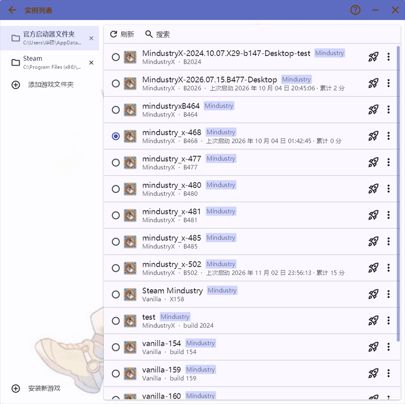
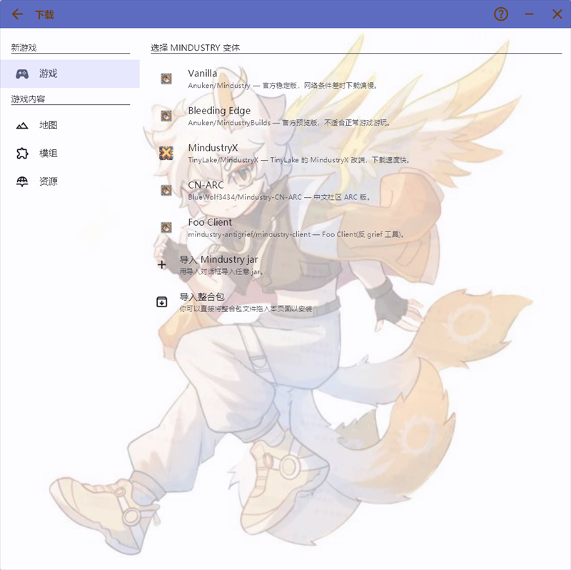
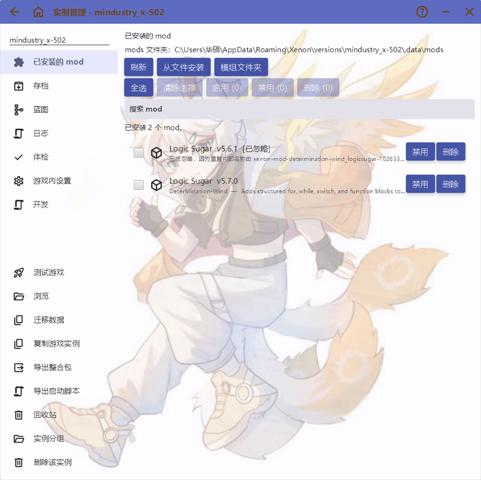
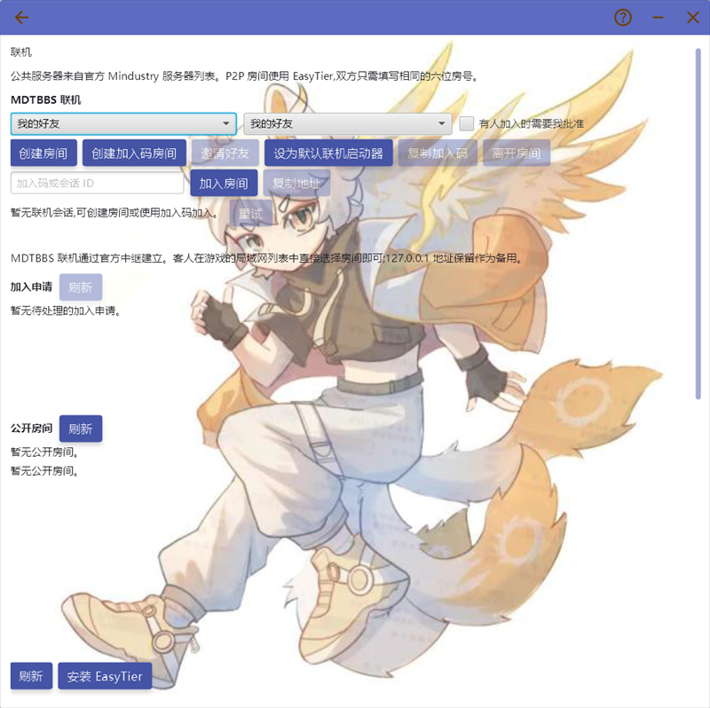

# Xenon - A Mindustry Launcher
<h1 align="center">
  
  
  
  
</h1>

> [!NOTE]
> If you have any feedback, please send it to bugsoc@qq.com / 若有反馈，请发送反馈到 bugsoc@qq.com

[中文](README.md) | **English**

> Versions, content, and servers for Mindustry, in one clear workspace.

## Overview

Xenon is a cross-platform desktop launcher and instance manager for Mindustry players and server owners. It brings installation, version switching, mods, maps, schematics, saves, cloud saves, the MDTBBS community, multiplayer, and server maintenance into one place, with isolated Java, launch arguments, and data directories for every instance.

Xenon is based on [HMCL](https://github.com/HMCL-dev/HMCL) but reorganizes the workflow around Mindustry. In mainland China, built-in mirrors, Wayzer's GitHub mirror, the MDT BBS file station, and public GitHub mirrors deliver 1–30 MB/s downloads; original builds use the MDT file station first and fall back automatically.

## Screenshots

Captured from a real Xenon 2.1.0 session on Windows (light theme, local instances).

| Instance list | Download and variant picker |
| :---: | :---: |
|  |  |
| **Instance detail and mod management** | **Multiplayer (MDTBBS 1.8)** |
|  |  |

## Highlights

- **Instance isolation and versions**: Vanilla, BE, MindustryX, CN-ARC, Foo Client, local jars, and Steam installs can coexist with optional per-instance isolation.
- **Install and download**: automatic Java and data-directory setup, resumable and pausable downloads, download source tiers, and mirror acceleration.
- **Content**: domestic mod mirror index and resources, batch enable/disable, drag-and-drop import; WZ/MDTBBS maps and schematics can be browsed, installed, imported, and exported inside the launcher; table-style editing and backup of `settings.bin` outside the game.
- **Saves and cloud**: local backup/export, recycle bin, automatic backup after exiting long sessions; cloud saves support single-save snapshots with keep-both conflict copies, file-level delta snapshots, whole-instance archives, and per-instance automatic sync.
- **MDTBBS multiplayer**: public room lobby, room creation by visibility scope and join permission, host approval, realtime events, friend invite/join actions, search-and-invite by username, and pseudo-LAN automatic discovery so guests can join directly from Mindustry's in-game LAN list. All operations are completed in-game.
- **Server management**: multiple server instances, console, auto-restart, and automatic configuration of the [ScriptAgent4Mindustry](https://github.com/way-zer/ScriptAgent4Mindustry) script environment.
- **Diagnostics and maintenance**: export instance logs and crash reports outside the game; outside the game, provide compatibility checks, memory suggestions, instance migration, and recycle bin.

## Quick Start

1. Download the [latest release](https://github.com/DeterMination-Wind/Xenon/releases): `Xenon.exe` single file for Windows, or the `.jar` for macOS/Linux (Java 17+).
2. Start Xenon, choose `Install Mindustry`, and install a version.
3. Open `Mindustry Versions` and launch the instance; its data directory is prepared automatically on first launch.
4. When MDTBBS login is required, follow the prompt to complete MindAuth authorization in the system browser and sign in to your MDTBBS account.

## Comparison with other launchers

<!-- LAST_UPDATED:START -->
Last updated: **v2.1.0** (2026-11-08)
<!-- LAST_UPDATED:END -->

> Compiled from public project documentation and the GitHub REST API. Competitor capabilities change over time; treat each project as the source of truth.

| Capability | Xenon | [BookMdtLauncher](https://github.com/ch-BookBanana/BookMdtLauncher) | [Copper Launcher](https://github.com/MDTCopper/launcher) | [MDL](https://github.com/colorgarden/mindustry_launcherMDL) | [MindustryLauncher](https://github.com/BalaM314/MindustryLauncher) |
| --- | --- | --- | --- | --- | --- |
| Platform / form factor | Windows / Linux / macOS · GUI | Windows · GUI (PySide6, single-file portable) | Windows / Linux / macOS / Android · GUI (Flutter, in development) | Windows 7+ · GUI (WPF, .NET 10) | Windows / Linux / macOS · CLI (Node.js) |
| Mobile (Android) | ❌ Desktop launcher; [Xenon-Mobile](https://github.com/DeterMination-Wind/Xenon-Mobile) is maintained separately | ❌ | ✅ Bundled Java and Copper bridge (mod support in development) | ❌ | ❌ |
| Game sources | Vanilla / BE / MindustryX / CN-ARC / Foo Client, local jar and Steam import | Vanilla / MindustryX / MindustryARC | Vanilla / BE | Vanilla | Vanilla / BE / Foo Client, custom jar and source directory |
| Java management | ✅ Multiple runtimes, auto-detection, Adoptium download, per-version match | ✅ Auto-detect and racing downloads | ✅ Multiple runtimes and auto-download | ✅ Scanning and memory allocation | ⚠️ Path configuration only |
| Instance isolation | ✅ Per-instance data directory | ✅ | ✅ | ✅ | ⚠️ Version directory only |
| Mod management | ✅ Community index, GitHub install, enable/disable, dependency fill | ❌ | ✅ Browse, enable/disable, search | ✅ Browse, search, install | ⚠️ Developer-oriented |
| Mod batch / drag-and-drop | ✅ Batch enable/disable/delete, drag files and folders, automatic unpack | ❌ | ✅ Multi-select, drag in, Windows drag out | ❌ | ❌ |
| Maps / schematics | ✅ mindustry.top, .msch, share codes, resource page | ❌ | ⚠️ Resource import/export | ✅ Community schematics | ❌ |
| Saves | ✅ Backup/export, recycle bin, automatic backup | ❌ | ⚠️ Resources and cloud saves (in development) | ✅ Scan/parse/delete | ❌ |
| Cloud saves | ✅ Single-save conflict handling + whole-instance archive + file-level delta (manifest) + automatic sync | ❌ | ⚠️ Whole archive/sync/conflict copies, delta/manifest snapshots (in development) | ❌ | ❌ |
| settings.bin editing | ✅ Full table, search, automatic backup and restore | ❌ | ⚠️ Overrides some settings at launch | ✅ Table editing and backup | ❌ |
| Community and multiplayer | ✅ MDTBBS 1.8.0, public lobby, approval list, limits, realtime events, pseudo-LAN | ❌ | ⚠️ Relay proxy, pseudo-LAN and launch session handoff (in development) | ✅ EasyTier lobby | ❌ |
| Extensions / login | ✅ MindAuth login, deep links, launch scripts, single-instance protocol | ✅ Plugin system v3, typed settings.bin codec, GitHub App login | ❌ | ❌ | ❌ |
| Mod development workflow | ✅ Build, deploy, watch, auto-restart | ❌ | ❌ | ❌ | ✅ Compile and auto-restart |
| Recycle bin / groups | ✅ Instance and save recycle bin, single-level groups | ❌ | ❌ | ❌ | ❌ |
| CLI / deep links / launch scripts | ✅ Headless CLI, `.bat/.sh`, three deep links | ❌ | ❌ | ❌ | ✅ CLI |
| China download acceleration | ✅ Multi-mirror fallback, GitHub CLI | ⚠️ JDK mirror only | ✅ Per-category speed test and custom nodes | ✅ 6 proxies | ❌ |
| Download source policy | ✅ Four tiers | ⚠️ No tier switch | ✅ Three tiers | ❌ | ❌ |
| Download rate limit | ✅ Global token bucket | ❌ | ✅ | ❌ | ❌ |
| Server management | ✅ Console, auto-restart, ScriptAgent | ❌ | ❌ | ❌ | ❌ |
| Last push (activity) | 2026-10-31 | 2026-10-31 | 2026-11-07 | 2026-06-28 | 2026-09-04 |
| License | GPLv3 | GPL-3.0 | MIT | AGPL-3.0 | Unspecified |

✅ Supported ｜ ❌ Not provided or not documented ｜ ⚠️ Partial or a different form

Other Windows-capable launchers:

- [GIML](https://github.com/SquareCM2/GIML) (WinUI 3, in development)
- [zenonet/MindustryLauncher](https://github.com/zenonet/MindustryLauncher) (Avalonia)
- [GXFQE/mindustry-launcher](https://github.com/GXFQE/mindustry-launcher) (Python/tkinter; CAS, isolated saves, automatic backup, CLI; v1.3.2 / v1.3.3 add five CLI switches with exit codes and version-name tolerance)
- [Eliezer516/mindustry-launcher](https://github.com/Eliezer516/mindustry-launcher) (last push 2026-10-27)
- [Walker196/Mindustry-Launcher](https://github.com/Walker196/Mindustry-Launcher) (Tauri + React + Rust)
- [NixaVulpi/MindustryLauncher](https://github.com/NixaVulpi/MindustryLauncher) (portable wrapper, bring your own jar/JRE)
- [kabaka9527/MindustryLauncher](https://github.com/kabaka9527/MindustryLauncher) (Tauri 2 + Rust + React 19)
- [UnQuis/SingularityLauncher](https://github.com/UnQuis/SingularityLauncher) (Java + Arc)
- [Plain-Mindustry-Launcher](https://github.com/taiko525/Plain-Mindustry-Launcher) (WPF, fixed Java 17)

Mobile / other platforms:

- [haohandc/MindustryArk](https://github.com/haohandc/MindustryArk) (HarmonyOS NEXT, C; repository split)
- [GXFQE/mindustry-launcher-android](https://github.com/GXFQE/mindustry-launcher-android) (Android, APK plugin)
- [EmmM9O/oxygen-launcher](https://github.com/EmmM9O/oxygen-launcher) (Android, Kotlin, discontinued)

## Documentation

- [User guide](docs/USAGE.md): installation, mods, saves, multiplayer, servers, and ScriptAgent.
- [Full feature list](FEATURE.md): every capability and the differences between builds.
- [Development and build](docs/DEVELOPMENT.md): build, test, package, and release workflow.
- [Changelog](CHANGELOG.md): release history.

## Contact

- [Bilibili](https://space.bilibili.com/1433776051)
- QQ group: `188709300`
- [GitHub Issues](https://github.com/DeterMination-Wind/Xenon/issues)

## Credits

Thanks to [Wayzer / TinyLake](https://github.com/way-zer) (ScriptAgent, MindustryX, and GitHub mirrors), [DeterMination](https://github.com/DeterMination-Wind) (mirrors and hosting), [MDTbbs](https://mdtbbs.cn/) (original Mindustry download mirror), [Xiuxian / 休闲](https://alist.mindustry.ltd/Github/MindustryX) (MindustryX mirror), [爱看番的年兽sama](https://space.bilibili.com/433674920) (default background), the [HMCL team](https://github.com/HMCL-dev/HMCL) (project foundation), [Anuken](https://github.com/Anuken) (Mindustry), and all [GitHub contributors](https://github.com/DeterMination-Wind/Xenon/graphs/contributors).

## License

GPLv3 (inherited from HMCL). See [LICENSE](LICENSE).
